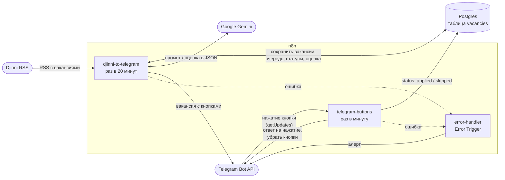
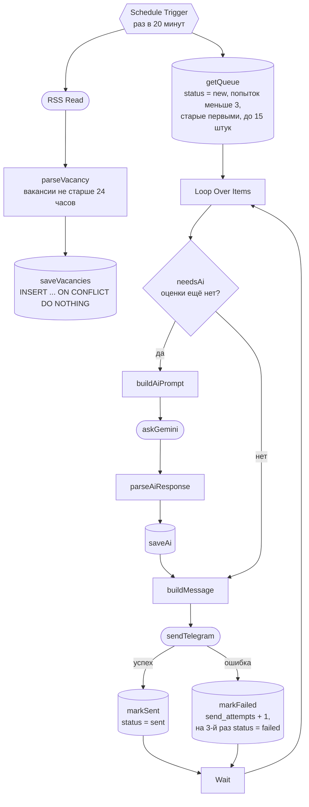

# djinni-job-bot

Бот на n8n: берёт вакансии из RSS Djinni, сохраняет их в Postgres, оценивает через Gemini и присылает в Telegram с кнопками «✅ Відгукнувся / ❌ Пропустити».

## Что делает бот

1. Раз в 20 минут читает RSS Djinni. Фильтры (`primary_keyword`, `exp_level`, `employment`, `english_level`) заданы прямо в URL ноды `RSS Read`.
2. Оставляет вакансии не старше 24 часов и сохраняет новые в Postgres. Номер из ссылки `/jobs/<номер>-...` становится `id`, поэтому вакансии, которые снова попали в ленту, не дублируются.
3. Берёт из базы очередь неотправленных вакансий: до 15 за запуск, старые первыми.
4. Если у вакансии ещё нет оценки, просит Gemini оценить, насколько она подходит кандидату (балл от 1 до 10), и выделить стек, требуемый английский, зарплату и короткое резюме.
5. Отправляет вакансию в Telegram с двумя кнопками.
6. Раз в минуту проверяет нажатия: ставит вакансии статус `applied` или `skipped`, показывает всплывающее уведомление и убирает кнопки из сообщения.
7. Если workflow падает, присылает алерт в тот же чат.

### Пример сообщения

```text
🆕 Junior React Developer
🎯 Підходить: 9/10
🧩 React, TypeScript, Redux Toolkit
🇬🇧 Intermediate
💰 $600–900
📝 Продуктова компанія розробляє вебзастосунок, завдання — інтерфейси на React.
🕒 сьогодні, 14:01
🔗 https://djinni.co/jobs/123456-junior-react-developer/

[ ✅ Відгукнувся ]   [ ❌ Пропустити ]
```

- Название приходит жирным (Parse Mode = HTML).
- Строки `🎯`, `🧩`, `🇬🇧`, `💰`, `📝` — результат Gemini, каждая выводится, только если поле заполнено. Если Gemini не ответил или ответил не по формату, приходят название, время и ссылка.
- Оценка только информирует: вакансии с низким баллом тоже приходят.
- Время показывается по Киеву: `сьогодні`, `вчора` или дата вида `13.01`.

## Архитектура

Три workflow работают в одном n8n. Общее состояние хранится в таблице `vacancies` в Postgres, а `error-handler` подключён как Error Workflow к двум остальным.



| Workflow | Запуск | Что внутри |
|---|---|---|
| `djinni-to-telegram` | Schedule Trigger, раз в 20 минут | сбор вакансий, очередь, оценка Gemini, отправка (схема ниже) |
| `telegram-buttons` | Schedule Trigger, раз в минуту | `getOffset` → `getUpdates` → `parseCallback` → `updateStatus` → `answerCallbackQuery` → `removeButtons` |
| `error-handler` | Error Trigger | `Send a text message`: алерт в Telegram |

### djinni-to-telegram по нодам

От триггера стартуют две ветки: сбор (RSS → Postgres) и отправка (очередь → Gemini → Telegram). Они связаны только через таблицу `vacancies`.



Обозначения: цилиндр — нода Postgres, скруглённая — запрос во внешний сервис (Djinni, Gemini, Telegram), шестиугольник — триггер, ромб — условие.

### Таблица `vacancies`

Схема лежит в `db/init.sql`: `id` (номер вакансии Djinni), `title`, `url`, `description`, `published_at`, `status`, `send_attempts`, `ai_score` (1–10), `ai_summary` (JSONB с разбором от ИИ), `telegram_message_id`, `created_at`, `updated_at` (обновляется триггером).

| Статус | Значение | Кто ставит |
|---|---|---|
| `new` | ещё не отправлена (значение по умолчанию) | `saveVacancies` |
| `sent` | отправлена, ждёт нажатия | `markSent` |
| `applied` | нажато «✅ Відгукнувся» | `updateStatus` в `telegram-buttons` |
| `skipped` | нажато «❌ Пропустити» | `updateStatus` в `telegram-buttons` |
| `failed` | не удалось отправить за 3 попытки | `markFailed` |

## Стек

- **n8n** в Docker (версия образа закреплена в `docker-compose.yml`): Schedule Trigger, RSS Read, Postgres, IF, Loop Over Items, Wait, Telegram, HTTP Request, Code, Error Trigger, а также ноды LangChain (Basic LLM Chain и Google Gemini Chat Model).
- **PostgreSQL** в Docker: вакансии, статусы, оценки.
- **Google Gemini** (модель Flash-Lite, имя задано в ноде `Google Gemini Chat Model`): оценка и разбор вакансии.
- **Telegram Bot API**: отправка сообщений с inline-кнопками нодой Telegram; `getUpdates`, `answerCallbackQuery` и `editMessageReplyMarkup` через HTTP Request.
- **Djinni RSS** — источник вакансий.
- **JavaScript (Node.js, CommonJS)**: код Code-нод в `src/`, скрипты в `scripts/`.
- **Jest** — тесты для `src/`.

Часовой пояс контейнера n8n — `Europe/Kyiv`.

## Установка

### Что понадобится

- Docker с Docker Compose.
- Node.js 20.6 или новее и npm (`npm run ai:try` использует флаг `--env-file`).
- Бот в Telegram (токен от @BotFather) и `chat_id`, в который он будет писать.
- Ключ Gemini API из Google AI Studio.

### Шаги

**1. Зависимости.** Склонируй репозиторий, перейди в его папку и выполни:

```bash
npm install
```

Это нужно только для `npm test` (Jest). Скрипты проекта используют встроенные модули Node.js.

**2. Файл `.env`.** Скопируй шаблон и заполни своими значениями:

```bash
cp .env.example .env
```

| Переменная | Для чего | Где используется |
|---|---|---|
| `TELEGRAM_BOT_TOKEN` | токен бота от @BotFather | HTTP Request-ноды `telegram-buttons` (`$env.TELEGRAM_BOT_TOKEN`) |
| `TELEGRAM_CHAT_ID` | `chat_id`, куда бот шлёт вакансии и алерты (подсказка из `.env.example`: число из `getUpdates`) | `sendTelegram` и нода алерта в `error-handler` |
| `GEMINI_API_KEY` | ключ Gemini API из Google AI Studio | только `npm run ai:try`; ноды n8n берут ключ из своего credential |
| `N8N_ENCRYPTION_KEY` | ключ шифрования credentials n8n | `docker-compose.yml`, обязательна |
| `POSTGRES_PASSWORD` | пароль пользователя БД `jobbot` | `docker-compose.yml`, обязательна |
| `GEMINI_MODEL` | необязательно: другая модель для `ai:try` | `scripts/gemini-try.js` |

`N8N_ENCRYPTION_KEY` и `POSTGRES_PASSWORD` отсутствуют в `.env.example`, но без них `docker compose up` остановится с ошибкой, поэтому добавь их в `.env` сам. В `N8N_ENCRYPTION_KEY` подойдёт любая длинная случайная строка. Задай её один раз и не меняй: с другим ключом n8n не сможет прочитать уже сохранённые credentials.

Переменные `TELEGRAM_BOT_TOKEN` и `TELEGRAM_CHAT_ID` передаются в контейнер n8n, а `N8N_BLOCK_ENV_ACCESS_IN_NODE=false` в `docker-compose.yml` разрешает читать их в выражениях через `$env`. Файл `.env` в `.gitignore`: секреты живут только в нём и в credentials n8n.

**3. Контейнеры.**

```bash
docker compose up -d
```

n8n открывается на http://localhost:5678. При первом запуске Postgres сам выполняет `db/init.sql` и создаёт таблицу `vacancies`. Позже этот файл автоматически не перезапускается, а `docker compose down -v` удаляет тома, то есть все данные базы и n8n.

С хоста к базе можно подключиться клиентом (DBeaver, VS Code) по `127.0.0.1:5433`, база и пользователь — `jobbot`.

**4. Credentials в n8n.** Создай их в интерфейсе (Credentials → Create credential):

| Credential | Как назван в workflow | Что указать | Используют |
|---|---|---|---|
| Telegram API | `Telegram account` | Access Token — токен бота (тот же, что в `TELEGRAM_BOT_TOKEN`) | `sendTelegram`, алерт в `error-handler` |
| Postgres | `Postgres account` | Host `postgres`, Port `5432`, Database `jobbot`, User `jobbot`, Password — значение `POSTGRES_PASSWORD` | все Postgres-ноды |
| Google Gemini(PaLM) API | `Google Gemini(PaLM) Api account` | API Key из Google AI Studio | `Google Gemini Chat Model` |

Host нужен именно `postgres` (имя сервиса в сети Docker), а не `localhost`. Порт `5433` существует только на хосте.

**5. Импорт workflow.**

```bash
npm run wf:import
```

Скрипт загружает в n8n все файлы из `workflows/`, заново публикует workflow, которые были активными на момент выгрузки, и перезапускает n8n. Контейнер n8n при этом должен быть запущен.

**6. Проверка.**

- Открой три workflow. Если у нод Telegram, Postgres или Gemini остался значок ошибки credentials, выбери в них созданные на шаге 4 credentials, сохрани и опубликуй workflow заново (в экспорте credentials привязаны по `id`, а на новой установке `id` другие).
- Убедись, что все три workflow опубликованы.
- Чтобы не ждать 20 минут, запусти `djinni-to-telegram` вручную из интерфейса n8n.

## Рабочий цикл разработки

```bash
# 1. Что-то поменял в интерфейсе n8n (ноды, SQL, расписание)? Сначала выгрузи workflow в репозиторий
npm run wf:export

# 2. Логику Code-нод правь только в src/*.js и проверяй тестами
npm test

# 3. Подставь код из src/ в Code-ноды и загрузи workflow в n8n
npm run sync
npm run wf:import
```

Главное правило: после любой правки в интерфейсе n8n сначала `npm run wf:export`, и только потом `sync` или `wf:import`. Иначе импорт перезапишет изменения из интерфейса версией из `workflows/`.

Что делают команды:

- `npm run wf:export` — n8n → `workflows/`. Удаляет старые `*.json`, выгружает все workflow (`export:workflow --all --separate --pretty`), убирает архивные и вырезает поле `shared` (там имя и email владельца), чтобы личные данные не попали в git.
- `npm run sync` — `src/` → `workflows/`. В каждой Code-ноде находит блоки между `// @include-start <файл>` и `// @include-end` и подставляет в них текст `src/<файл>`. Переводы строк приводятся к `\n`, строка `module.exports = ...` вырезается (она нужна только Jest). Файл переписывается, только если что-то изменилось.
- `npm run wf:import` — `workflows/` → n8n. CLI-импорт n8n снимает публикацию, поэтому скрипт заново публикует workflow с `"active": true` и перезапускает n8n, чтобы он подхватил новые версии и расписания.

### Почему код не правят в Code-нодах

- **Один источник правды.** `sync` перезаписывает всё между маркерами, поэтому правка внутри блока пропадёт при следующем запуске.
- **Тесты.** Функции в `src/` — чистый JavaScript без `$input`, сети и базы. Jest проверяет их до того, как код попадёт в n8n.
- **Читаемые диффы.** В JSON код лежит одной экранированной строкой `jsCode`, в `src/` — обычным файлом.
- **Повторное использование.** `scripts/gemini-try.js` подключает `buildAiPrompt` и `parseAiResponse` из `src/` и проверяет промпт на живых вакансиях без n8n.

### Как код попадает в ноду

Между маркерами лежит копия файла из `src/`, а ниже — «клей», который подключает функцию к данным n8n. Клей правится в интерфейсе n8n (потом `npm run wf:export`).

```js
// @include-start parseVacancy.js
// ...сюда `npm run sync` подставляет текст src/parseVacancy.js...
// @include-end

// --- «клей»: подключаем функцию к данным n8n ---
const MAX_AGE_HOURS = 24;
const now = new Date();

return $input.all()
  .map((item) => parseVacancy(item.json, { now, maxAgeHours: MAX_AGE_HOURS }))
  .filter(Boolean)
  .map((vacancy) => ({ json: vacancy }));
```

Требования к файлам в `src/`:

- `module.exports = ...` должен занимать одну строку: `sync` вырезает ровно одну строку.
- В ноду попадает только текст файла, поэтому `require` на соседние файлы там не сработает.
- Чтобы подключить новый файл, добавь в Code-ноде пару маркеров `// @include-start имя.js` и `// @include-end`, затем выполни `npm run wf:export` и `npm run sync`.

Профиль кандидата и правила оценки заданы константами `PROFILE` и `SCORING` в `src/buildAiPrompt.js`. Личных данных там быть не должно: промпт уходит в Gemini, а файл лежит в git (тест проверяет, что в `PROFILE` нет почты, телефонов и ссылок).

### Проверка промпта на живых данных

```bash
npm run ai:try                      # две последние вакансии из базы
npm run ai:try -- 3 --show-prompt   # три вакансии и показать промпт
```

Скрипт берёт последние вакансии из Postgres (контейнер `postgres` должен быть запущен), строит промпт тем же `buildAiPrompt`, спрашивает Gemini напрямую, без n8n, и печатает сырой ответ, результат `parseAiResponse` и расход токенов. Количество вакансий — от 1 до 5. Нужен `GEMINI_API_KEY` в `.env`.

Перед коммитом выгрузку в `workflows/` можно проверить субагентом Claude Code `n8n-workflow-reviewer`: он смотрит на Error Workflow, повторы на сетевых нодах, секреты и соответствие Code-нод файлам из `src/`.

## Надёжность

- **Дедупликация.** `id` — первичный ключ `vacancies` (номер вакансии Djinni). `saveVacancies` выполняет `INSERT ... ON CONFLICT (id) DO NOTHING`: вакансия, которая приходит в RSS при каждом запуске, второй раз не вставляется, а её статус и оценка не затираются.
- **Повторы отправки: `send_attempts` и `failed`.**
  - Очередь строится из базы: `getQueue` берёт вакансии со `status = 'new'` и `send_attempts < 3`.
  - У `sendTelegram` стоит `onError: continueErrorOutput`. При ошибке отправки вакансия идёт в `markFailed`: он увеличивает `send_attempts`, а на третьей неудаче ставит `status = 'failed'`. До этого вакансия остаётся `new` и уйдёт при следующем запуске.
  - Цикл не прерывается: после `markFailed` и паузы `Wait` бот переходит к следующей вакансии.
  - Автоповтор на самой ноде `sendTelegram` не включён: повторная отправка могла бы продублировать сообщение, поэтому повторы идут только через очередь.
  - Отдельного уведомления о переходе в `failed` в workflow нет: такие вакансии видны в таблице `vacancies`.
- **Error workflow.** В настройках `djinni-to-telegram` и `telegram-buttons` Error Workflow — `error-handler`. При необработанной ошибке он присылает в чат `TELEGRAM_CHAT_ID` алерт, а сама нода алерта повторяет отправку при сбое (`retryOnFail`). Ошибки, которые ноды обрабатывают на месте (`onError: continue...` у `sendTelegram`, `askGemini`, `answerCallbackQuery`, `removeButtons`), запуск не роняют и алерт не вызывают.

  ```text
  🚨 Упал workflow «djinni-to-telegram»
  Нода: RSS Read
  Ошибка: <текст ошибки>
  <ссылка на запуск в n8n>
  ```

- **Кнопки через long polling.**
  - `getOffset` берёт из static data workflow номер последнего обработанного обновления (`lastUpdateId`), а `getUpdates` просит у Telegram только более новые, с `timeout: 50` и `allowed_updates: ["callback_query"]`.
  - Telegram держит запрос открытым до нажатия, поэтому webhook, публичный адрес и входящие соединения не нужны. Нажатие между запросами не теряется: Telegram хранит обновления до следующего `getUpdates`.
  - `parseCallback` сразу запоминает новый `lastUpdateId`, и одно нажатие не обрабатывается повторно.
  - Статус в Postgres записывается раньше, чем бот отвечает Telegram. `answerCallbackQuery` и `removeButtons` работают в режиме «продолжить при ошибке», поэтому сбой ответа не отменяет решение.
- **ИИ не блокирует отправку.**
  - `askGemini` стоит в режиме `onError: continueRegularOutput`: ошибка Gemini не останавливает запуск.
  - `parseAiResponse` достаёт JSON, даже если он обёрнут в блок кода или окружён лишним текстом, приводит балл к диапазону 1–10 и чистит поля. При любом сбое возвращает `null`.
  - В этом случае `saveAi` записывает `NULL`, а `buildMessage` не выводит строки с оценкой: вакансия всё равно уходит в Telegram.
- **Повторы на сетевых нодах.** `RSS Read`, `getUpdates` и нода алерта в `error-handler` повторяют запрос при ошибке (`retryOnFail`).
- **Безопасная разметка.** `buildMessage` экранирует `<`, `>` и `&` в названии, ссылке и ответе Gemini, поэтому текст вакансии не ломает HTML-разметку и Telegram не отклоняет сообщение.

## Структура проекта

```text
.
├── CLAUDE.md                # команды и правила проекта для Claude Code
├── README.md
├── docker-compose.yml       # n8n и Postgres
├── package.json             # npm-скрипты и Jest
├── package-lock.json
├── .env.example             # шаблон .env (сам .env в git не попадает)
├── .gitignore
├── .claude/
│   ├── settings.json        # настройки Claude Code (в том числе запрет чтения .env)
│   └── agents/              # субагенты: docs-writer, n8n-workflow-reviewer, test-writer
├── db/
│   └── init.sql             # схема: таблица vacancies, частичный индекс, триггер updated_at
├── scripts/
│   ├── n8n-cli.js           # общая обёртка: docker compose exec n8n n8n ...
│   ├── wf-export.js         # npm run wf:export
│   ├── wf-import.js         # npm run wf:import
│   ├── sync-code.js         # npm run sync
│   └── gemini-try.js        # npm run ai:try
├── src/                     # код Code-нод (чистые функции) и тесты
│   ├── parseVacancy.js      # нода parseVacancy: item RSS -> вакансия
│   ├── buildAiPrompt.js     # нода buildAiPrompt: промпт для Gemini
│   ├── parseAiResponse.js   # нода parseAiResponse: ответ Gemini -> оценка и разбор
│   ├── buildMessage.js      # нода buildMessage: текст сообщения для Telegram
│   ├── parseCallback.js     # нода parseCallback (telegram-buttons): нажатие кнопки -> действие
│   └── __tests__/           # Jest-тесты, по файлу на каждый модуль
└── workflows/               # экспорт workflow из n8n, имя файла = id workflow
    ├── <id>.json            # djinni-to-telegram
    ├── <id>.json            # telegram-buttons
    └── <id>.json            # error-handler
```
