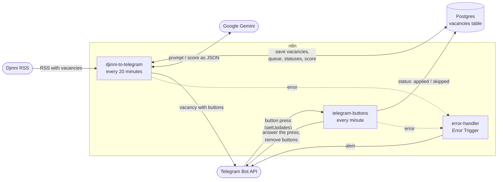
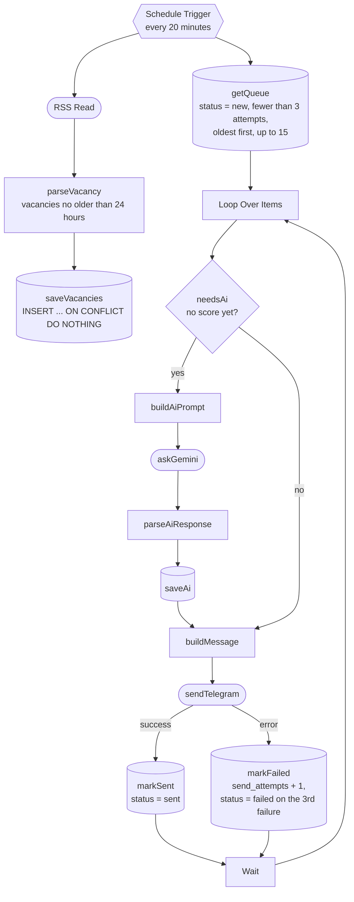

# djinni-job-bot

An n8n bot that takes vacancies from the Djinni RSS feed, stores them in Postgres, scores them with Gemini and sends them to Telegram with «✅ Відгукнувся / ❌ Пропустити» ("Applied / Skip") buttons.

## What the bot does

1. Every 20 minutes it reads the Djinni RSS feed. The filters (`primary_keyword`, `exp_level`, `employment`, `english_level`) are set right in the URL of the `RSS Read` node.
2. It keeps vacancies no older than 24 hours and saves the new ones to Postgres. The number from the `/jobs/<number>-...` link becomes the `id`, so vacancies that show up in the feed again are not duplicated.
3. It takes the queue of unsent vacancies from the database: up to 15 per run, oldest first.
4. If a vacancy has no score yet, it asks Gemini to rate how well it fits the candidate (a score from 1 to 10) and to extract the stack, the required English level, the salary and a short summary.
5. It sends the vacancy to Telegram with two buttons.
6. Once a minute it checks for button presses: sets the vacancy status to `applied` or `skipped`, shows a pop-up notification and removes the buttons from the message.
7. If a workflow fails, it sends an alert to the same chat.

### Example message

```text
🆕 Junior React Developer
🎯 Підходить: 9/10
🧩 React, TypeScript, Redux Toolkit
🇬🇧 Intermediate
💰 $600–900
📝 Продуктова компанія розробляє вебзастосунок, завдання — інтерфейси на React.
🕒 сьогодні, 14:01
🔗 https://djinni.co/jobs/123456-junior-react-developer/

[ ✅ Відгукнувся ]   [ ❌ Пропустити ]
```

- The title arrives in bold (Parse Mode = HTML).
- The `🎯`, `🧩`, `🇬🇧`, `💰`, `📝` lines come from Gemini, and each one is shown only if its field is filled. If Gemini didn't respond or responded in the wrong format, the message contains the title, time and link.
- The score is informational only: vacancies with a low score are delivered too.
- Time is shown in Kyiv time: `сьогодні` (today), `вчора` (yesterday) or a date like `13.01`.

## Architecture

Three workflows run in one n8n instance. Shared state lives in the `vacancies` table in Postgres, and `error-handler` is attached as the Error Workflow to the other two.



| Workflow | Trigger | What's inside |
|---|---|---|
| `djinni-to-telegram` | Schedule Trigger, every 20 minutes | collecting vacancies, queue, Gemini scoring, sending (diagram below) |
| `telegram-buttons` | Schedule Trigger, every minute | `getOffset` → `getUpdates` → `parseCallback` → `updateStatus` → `answerCallbackQuery` → `removeButtons` |
| `error-handler` | Error Trigger | `Send a text message`: alert to Telegram |

### djinni-to-telegram node by node

Two branches start from the trigger: collecting (RSS → Postgres) and sending (queue → Gemini → Telegram). They are connected only through the `vacancies` table.



Legend: cylinder — Postgres node, rounded — request to an external service (Djinni, Gemini, Telegram), hexagon — trigger, diamond — condition.

### The `vacancies` table

The schema is in `db/init.sql`: `id` (Djinni vacancy number), `title`, `url`, `description`, `published_at`, `status`, `send_attempts`, `ai_score` (1–10), `ai_summary` (JSONB with the AI breakdown), `telegram_message_id`, `created_at`, `updated_at` (updated by a trigger).

| Status | Meaning | Set by |
|---|---|---|
| `new` | not sent yet (the default value) | `saveVacancies` |
| `sent` | sent, waiting for a press | `markSent` |
| `applied` | «✅ Відгукнувся» pressed | `updateStatus` in `telegram-buttons` |
| `skipped` | «❌ Пропустити» pressed | `updateStatus` in `telegram-buttons` |
| `failed` | could not be sent in 3 attempts | `markFailed` |

## Stack

- **n8n** in Docker (the image version is pinned in `docker-compose.yml`): Schedule Trigger, RSS Read, Postgres, IF, Loop Over Items, Wait, Telegram, HTTP Request, Code, Error Trigger, plus the LangChain nodes (Basic LLM Chain and Google Gemini Chat Model).
- **PostgreSQL** in Docker: vacancies, statuses, scores.
- **Google Gemini** (a Flash-Lite model, the name is set in the `Google Gemini Chat Model` node): scoring and analysis of the vacancy.
- **Telegram Bot API**: messages with inline buttons are sent by the Telegram node; `getUpdates`, `answerCallbackQuery` and `editMessageReplyMarkup` go through HTTP Request.
- **Djinni RSS** — the source of vacancies.
- **JavaScript (Node.js, CommonJS)**: Code node code in `src/`, scripts in `scripts/`.
- **Jest** — tests for `src/`.
- **Oracle Cloud Always Free** — an arm64 Ubuntu VM where the bot runs 24/7 (see [Deployment](#deployment)).

The n8n container's time zone is `Europe/Kyiv`.

## Setup

### Requirements

- Docker with Docker Compose.
- Node.js 20.6 or newer and npm (`npm run ai:try` uses the `--env-file` flag).
- A Telegram bot (token from @BotFather) and the `chat_id` it will write to.
- A Gemini API key from Google AI Studio.

### Steps

**1. Dependencies.** Clone the repository, go to its folder and run:

```bash
npm install
```

This is only needed for `npm test` (Jest). The project scripts use built-in Node.js modules.

**2. The `.env` file.** Copy the template and fill in your values:

```bash
cp .env.example .env
```

| Variable | Purpose | Used in |
|---|---|---|
| `TELEGRAM_BOT_TOKEN` | bot token from @BotFather | HTTP Request nodes of `telegram-buttons` (`$env.TELEGRAM_BOT_TOKEN`) |
| `TELEGRAM_CHAT_ID` | the `chat_id` the bot sends vacancies and alerts to (the hint in `.env.example`: the number from `getUpdates`) | `sendTelegram` and the alert node in `error-handler` |
| `GEMINI_API_KEY` | Gemini API key from Google AI Studio | only `npm run ai:try`; n8n nodes take the key from their credential |
| `N8N_ENCRYPTION_KEY` | key that encrypts n8n credentials | `docker-compose.yml`, required |
| `POSTGRES_PASSWORD` | password of the `jobbot` database user | `docker-compose.yml`, required |
| `GEMINI_MODEL` | optional: a different model for `ai:try` | `scripts/gemini-try.js` |

`N8N_ENCRYPTION_KEY` and `POSTGRES_PASSWORD` are missing from `.env.example`, but without them `docker compose up` stops with an error, so add them to `.env` yourself. Any long random string works for `N8N_ENCRYPTION_KEY`. Set it once and never change it: with a different key n8n can't read the credentials it has already saved.

`TELEGRAM_BOT_TOKEN` and `TELEGRAM_CHAT_ID` are passed into the n8n container, and `N8N_BLOCK_ENV_ACCESS_IN_NODE=false` in `docker-compose.yml` allows reading them in expressions via `$env`. `.env` is listed in `.gitignore`: secrets live only there and in n8n credentials.

**3. Containers.**

```bash
docker compose up -d
```

n8n opens at http://localhost:5678. On the first start Postgres runs `db/init.sql` by itself and creates the `vacancies` table. Later this file is not re-run automatically, and `docker compose down -v` deletes the volumes, that is, all database and n8n data.

From the host you can connect to the database with a client (DBeaver, VS Code) at `127.0.0.1:5433`; the database and the user are both `jobbot`.

**4. Credentials in n8n.** Create them in the UI (Credentials → Create credential):

| Credential | Name in the workflows | What to enter | Used by |
|---|---|---|---|
| Telegram API | `Telegram account` | Access Token — the bot token (the same as in `TELEGRAM_BOT_TOKEN`) | `sendTelegram`, the alert in `error-handler` |
| Postgres | `Postgres account` | Host `postgres`, Port `5432`, Database `jobbot`, User `jobbot`, Password — the `POSTGRES_PASSWORD` value | all Postgres nodes |
| Google Gemini(PaLM) API | `Google Gemini(PaLM) Api account` | API Key from Google AI Studio | `Google Gemini Chat Model` |

The host must be `postgres` (the service name in the Docker network), not `localhost`. Port `5433` exists only on the host.

**5. Import the workflows.**

```bash
npm run wf:import
```

The script loads every file from `workflows/` into n8n, re-publishes the workflows that were active at export time and restarts n8n. The n8n container must be running.

**6. Check.**

- Open the three workflows. If a Telegram, Postgres or Gemini node still shows a credentials error, select the credentials created in step 4, save and publish the workflow again (in the export, credentials are linked by `id`, and a new installation has different `id`s).
- Make sure all three workflows are published.
- To avoid waiting 20 minutes, run `djinni-to-telegram` manually from the n8n UI.

## Deployment

The bot runs 24/7 on an Oracle Cloud Always Free VM with the same `docker-compose.yml` as locally. Only SSH is reachable from the internet:

- n8n and Postgres publish their ports only on `127.0.0.1`;
- the bot polls Telegram with `getUpdates`, so it needs no webhook and no incoming connections;
- the n8n editor is opened through an SSH tunnel.

### Server

| | |
|---|---|
| Shape | `VM.Standard.A1.Flex` (Ampere, arm64), 1 OCPU, 4 GB RAM |
| OS | Ubuntu 24.04 |
| Network | public subnet with a public IPv4, only port 22 (SSH) has to be reachable |

- The n8n and Postgres images are multi-arch: Docker pulls the `linux/arm64` variants, and the compose file works unchanged.
- Free A1 capacity in popular regions is often exhausted (`Out of capacity for shape VM.Standard.A1.Flex`). Retry later or in another availability domain.
- Always Free instances that stay idle for 7 days can be reclaimed: CPU (95th percentile), network and, for A1 shapes, memory utilization all below 20%. Check the instance's Monitoring tab now and then.

An SSH alias in `~/.ssh/config` on the local machine saves typing the IP. `ServerAliveInterval` keeps the tunnel from dropping while it's idle:

```text
Host djinni
  HostName <server-ip>
  User ubuntu
  ServerAliveInterval 60
```

### 1. Prepare the server

```bash
curl -fsSL https://get.docker.com | sudo sh   # Docker Engine and the Compose plugin
sudo usermod -aG docker $USER                 # docker without sudo, after re-login
sudo fallocate -l 2G /swapfile                # 2 GB of swap as a safety net
sudo chmod 600 /swapfile
sudo mkswap /swapfile
sudo swapon /swapfile
echo '/swapfile none swap sw 0 0' | sudo tee -a /etc/fstab
```

### 2. Code and `.env`

While the repository is private, the server clones it with a read-only deploy key (a public repository can simply be cloned over HTTPS):

```bash
ssh-keygen -t ed25519 -f ~/.ssh/github_deploy -N "" -C "oracle-server"
cat >> ~/.ssh/config <<'EOF'
Host github.com
  IdentityFile ~/.ssh/github_deploy
  IdentitiesOnly yes
EOF
chmod 600 ~/.ssh/config
cat ~/.ssh/github_deploy.pub   # GitHub → Settings → Deploy keys → Add deploy key, without write access
git clone git@github.com:<user>/djinni-job-bot.git ~/djinni-job-bot
```

`.env` never goes through git. Copy it from the project folder on the local machine and make it readable only by its owner:

```bash
scp .env djinni:djinni-job-bot/       # local machine
chmod 600 ~/djinni-job-bot/.env       # server
```

### 3. Move the running instance

This moves the existing local installation as is: the n8n owner account, credentials, workflows with their published state and the Telegram offset in static data. `.env` on the server must contain the same `N8N_ENCRYPTION_KEY`, otherwise n8n can't decrypt the credentials.

On the local machine (Git Bash on Windows; `MSYS_NO_PATHCONV=1` stops Git Bash from rewriting the container path):

```bash
docker compose stop -t 60 n8n
MSYS_NO_PATHCONV=1 docker run --rm --volumes-from $(docker compose ps -aq n8n) alpine tar czf - -C /home/node/.n8n . > ~/n8n_data.tgz
docker compose exec -T postgres pg_dump -U jobbot -d jobbot --clean --if-exists > ~/jobbot.sql
scp ~/n8n_data.tgz ~/jobbot.sql djinni:
```

- `-t 60`: Docker kills a container 10 seconds after `stop` by default, while n8n waits up to 30 seconds for running executions before exiting.
- The archive and the dump are written outside the repository folder, so they can't be committed by accident.

On the server, everything is restored before n8n starts for the first time:

```bash
cd ~/djinni-job-bot
docker compose up -d postgres
until docker compose exec -T postgres pg_isready -h 127.0.0.1 -U jobbot -d jobbot; do sleep 2; done
docker compose exec -T postgres psql -v ON_ERROR_STOP=1 -U jobbot -d jobbot < ~/jobbot.sql
docker compose up --no-start n8n
docker run --rm -i --volumes-from $(docker compose ps -aq n8n) alpine sh -c "tar xzf - -C /home/node/.n8n && chown -R 1000:1000 /home/node/.n8n" < ~/n8n_data.tgz
docker compose up -d
```

- `pg_isready -h 127.0.0.1` waits for the final server: while `db/init.sql` runs on the first start, Postgres accepts only local socket connections.
- `--clean --if-exists` replaces the empty table created by `init.sql` with the dumped one.
- The vacancies are restored before n8n starts: against an empty table, the first `djinni-to-telegram` run would treat every RSS item as new and send it again.
- `up --no-start` creates the n8n volume without starting n8n, so the archive is unpacked into an empty volume and doesn't mix with a fresh `database.sqlite`. `chown 1000:1000` hands the files to the `node` user that n8n runs as.
- On its first start n8n reports the executions interrupted by the stop on the local machine, and `error-handler` may send an alert about them.

For a fresh install with nothing to move, follow [Setup](#setup) on the server instead; `npm run wf:import` needs Node.js there.

### 4. Open the editor

```bash
ssh -N -L 5679:localhost:5678 djinni
```

Then open http://localhost:5679. The tunnel lives only while this command runs; the bot keeps working without it. Port 5679 avoids a clash with a local n8n on 5678.

### One instance per bot

Two n8n instances with the same `TELEGRAM_BOT_TOKEN` get in each other's way: overlapping `getUpdates` calls fail with `409 Conflict`, and both instances send the same vacancies. After the move, the local stack stays stopped (`docker compose stop`).

### Rolling out changes

```bash
cd ~/djinni-job-bot
git pull
docker compose exec -T n8n n8n import:workflow --separate --input=/workflows
docker compose exec -T n8n n8n publish:workflow --id=<workflow-id>   # for every workflow that should be published
docker compose restart n8n
```

These are the same n8n CLI calls that `npm run wf:import` makes, so Node.js isn't needed on the server. The workflow id is the file name in `workflows/`.

## Development workflow

```bash
# 1. Changed something in the n8n UI (nodes, SQL, schedule)? Export the workflows to the repository first
npm run wf:export

# 2. Edit Code node logic only in src/*.js and check it with tests
npm test

# 3. Put the code from src/ into the Code nodes and load the workflows into n8n
npm run sync
npm run wf:import
```

The main rule: after any change in the n8n UI, run `npm run wf:export` first and only then `sync` or `wf:import`. Otherwise the import overwrites the UI changes with the version from `workflows/`.

What the commands do:

- `npm run wf:export` — n8n → `workflows/`. Deletes the old `*.json`, exports all workflows (`export:workflow --all --separate --pretty`), drops archived ones and cuts out the `shared` field (it holds the owner's name and email) so personal data doesn't get into git.
- `npm run sync` — `src/` → `workflows/`. In every Code node it finds the blocks between `// @include-start <file>` and `// @include-end` and puts the text of `src/<file>` into them. Line endings are normalized to `\n`, and the `module.exports = ...` line is cut out (only Jest needs it). A file is rewritten only if something changed.
- `npm run wf:import` — `workflows/` → n8n. The n8n CLI import unpublishes workflows, so the script re-publishes the ones with `"active": true` and restarts n8n so it picks up the new versions and schedules.

### Why code is not edited in Code nodes

- **Single source of truth.** `sync` overwrites everything between the markers, so an edit inside a block is lost on the next run.
- **Tests.** Functions in `src/` are plain JavaScript without `$input`, network or database. Jest checks them before the code gets into n8n.
- **Readable diffs.** In JSON the code is a single escaped `jsCode` string; in `src/` it's a normal file.
- **Reuse.** `scripts/gemini-try.js` requires `buildAiPrompt` and `parseAiResponse` from `src/` and tests the prompt on live vacancies without n8n.

### How code gets into a node

Between the markers there is a copy of the file from `src/`, and below it is the "glue" that connects the function to n8n data. The glue is edited in the n8n UI (followed by `npm run wf:export`).

```js
// @include-start parseVacancy.js
// ...`npm run sync` inserts the text of src/parseVacancy.js here...
// @include-end

// --- "glue": connect the function to n8n data ---
const MAX_AGE_HOURS = 24;
const now = new Date();

return $input.all()
  .map((item) => parseVacancy(item.json, { now, maxAgeHours: MAX_AGE_HOURS }))
  .filter(Boolean)
  .map((vacancy) => ({ json: vacancy }));
```

Requirements for files in `src/`:

- `module.exports = ...` must fit on one line: `sync` cuts out exactly one line.
- Only the file's text gets into the node, so `require` of neighbouring files won't work there.
- To include a new file, add a pair of markers `// @include-start name.js` and `// @include-end` to the Code node, then run `npm run wf:export` and `npm run sync`.

The candidate profile and the scoring rules are set by the `PROFILE` and `SCORING` constants in `src/buildAiPrompt.js`. There must be no personal data there: the prompt goes to Gemini and the file is in git (a test checks that `PROFILE` contains no emails, phone numbers or links).

### Testing the prompt on live data

```bash
npm run ai:try                      # the two latest vacancies from the database
npm run ai:try -- 3 --show-prompt   # three vacancies, and print the prompt
```

The script takes the latest vacancies from Postgres (the `postgres` container must be running), builds the prompt with the same `buildAiPrompt`, asks Gemini directly, without n8n, and prints the raw answer, the `parseAiResponse` result and the token usage. The number of vacancies is from 1 to 5. Requires `GEMINI_API_KEY` in `.env`.

Before committing, the export in `workflows/` can be checked with the Claude Code subagent `n8n-workflow-reviewer`: it looks at the Error Workflow, retries on network nodes, secrets and whether the Code nodes match the files in `src/`.

## Reliability

- **Deduplication.** `id` is the primary key of `vacancies` (the Djinni vacancy number). `saveVacancies` runs `INSERT ... ON CONFLICT (id) DO NOTHING`: a vacancy that appears in the RSS on every run is not inserted a second time, and its status and score are not overwritten.
- **Send retries: `send_attempts` and `failed`.**
  - The queue is built from the database: `getQueue` takes vacancies with `status = 'new'` and `send_attempts < 3`.
  - `sendTelegram` has `onError: continueErrorOutput`. If sending fails, the vacancy goes to `markFailed`: it increments `send_attempts` and on the third failure sets `status = 'failed'`. Until then the vacancy stays `new` and goes out on the next run.
  - The loop is not interrupted: after `markFailed` and the `Wait` pause, the bot moves on to the next vacancy.
  - Automatic retry on the `sendTelegram` node itself is not enabled: a repeated send could duplicate the message, so retries go only through the queue.
  - The workflow sends no separate notification when a vacancy becomes `failed`: such vacancies are visible in the `vacancies` table.
- **Error workflow.** In the settings of `djinni-to-telegram` and `telegram-buttons`, the Error Workflow is `error-handler`. On an unhandled error it sends an alert to the `TELEGRAM_CHAT_ID` chat, and the alert node itself retries on failure (`retryOnFail`). Errors that nodes handle in place (`onError: continue...` on `sendTelegram`, `askGemini`, `answerCallbackQuery`, `removeButtons`) don't fail the run and don't trigger an alert.

  ```text
  🚨 Упал workflow «djinni-to-telegram»
  Нода: RSS Read
  Ошибка: <error message>
  <link to the execution in n8n>
  ```

- **Buttons via long polling.**
  - `getOffset` takes the number of the last processed update (`lastUpdateId`) from the workflow's static data, and `getUpdates` asks Telegram only for newer ones, with `timeout: 50` and `allowed_updates: ["callback_query"]`.
  - Telegram keeps the request open until a press, so no webhook, public address or incoming connections are needed. A press between requests is not lost: Telegram stores updates until the next `getUpdates`.
  - `parseCallback` immediately saves the new `lastUpdateId`, so one press is never processed twice.
  - The status is written to Postgres before the bot answers Telegram. `answerCallbackQuery` and `removeButtons` run in "continue on error" mode, so a failed answer doesn't cancel the decision.
- **AI never blocks sending.**
  - `askGemini` runs in `onError: continueRegularOutput` mode: a Gemini error doesn't stop the run.
  - `parseAiResponse` extracts the JSON even if it's wrapped in a code block or surrounded by extra text, clamps the score to the 1–10 range and cleans up the fields. On any failure it returns `null`.
  - In that case `saveAi` writes `NULL`, and `buildMessage` leaves out the score lines: the vacancy still goes to Telegram.
- **Retries on network nodes.** `RSS Read`, `getUpdates` and the alert node in `error-handler` retry the request on error (`retryOnFail`).
- **Safe markup.** `buildMessage` escapes `<`, `>` and `&` in the title, the link and the Gemini answer, so the vacancy text doesn't break the HTML markup and Telegram doesn't reject the message.

## Project structure

```text
.
├── CLAUDE.md                # project commands and rules for Claude Code
├── README.md
├── docker-compose.yml       # n8n and Postgres
├── package.json             # npm scripts and Jest
├── package-lock.json
├── .env.example             # .env template (.env itself never goes to git)
├── .gitignore
├── .claude/
│   ├── settings.json        # Claude Code settings (including a ban on reading .env)
│   └── agents/              # subagents: docs-writer, n8n-workflow-reviewer, test-writer
├── db/
│   └── init.sql             # schema: vacancies table, partial index, updated_at trigger
├── scripts/
│   ├── n8n-cli.js           # shared wrapper: docker compose exec n8n n8n ...
│   ├── wf-export.js         # npm run wf:export
│   ├── wf-import.js         # npm run wf:import
│   ├── sync-code.js         # npm run sync
│   └── gemini-try.js        # npm run ai:try
├── src/                     # Code node code (pure functions) and tests
│   ├── parseVacancy.js      # parseVacancy node: RSS item -> vacancy
│   ├── buildAiPrompt.js     # buildAiPrompt node: prompt for Gemini
│   ├── parseAiResponse.js   # parseAiResponse node: Gemini answer -> score and breakdown
│   ├── buildMessage.js      # buildMessage node: Telegram message text
│   ├── parseCallback.js     # parseCallback node (telegram-buttons): button press -> action
│   └── __tests__/           # Jest tests, one file per module
└── workflows/               # workflows exported from n8n, file name = workflow id
    ├── <id>.json            # djinni-to-telegram
    ├── <id>.json            # telegram-buttons
    └── <id>.json            # error-handler
```